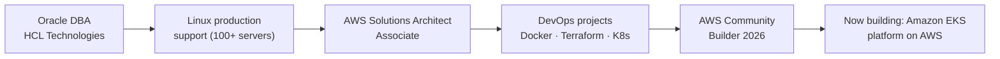

<!-- Banner: animated SVG; clicking it opens ranbirkaur.online -->
<p align="center">
  <a href="https://ranbirkaur.online">
    
  </a>
</p>

<p align="center">
  
</p>

<p align="center">
  <a href="https://ranbirkaur.online"></a>
  <a href="https://linkedin.com/in/ranbirkaur/"></a>
  <a href="https://medium.com/@ranbir11"></a>
  <a href="mailto:ranbir@ranbirkaur.online"></a>
  
</p>

---

## About me

```yaml
name: Ranbir Kaur
role: DevOps & Cloud Infrastructure Engineer
location: Perth, Western Australia (Australian PR)
background: Oracle DBA -> Linux production support -> DevOps
experience:
  - Production support for 100+ Linux servers in enterprise environments
  - 150+ incidents and change requests handled each month (SLA-driven)
  - Oracle and DB2 databases, monitoring and patching
focus: [AWS, Docker, Kubernetes, Terraform, GitHub Actions, Agentic AI]
currently_building: [Amazon EKS platform on AWS, GitOps with Argo CD, Agentic AI for DevOps]
community: AWS Community Builder (2026), DevOps co-mentor, 30+ technical articles
open_to: DevOps Engineer and Cloud Infrastructure roles
```

---

## Tech stack

<p align="center">
  
  <br />
  
</p>

<p align="center">
  
  
  
</p>

---

## My journey



---

## Featured projects

| Project | What it shows | Stack | Status |
| --- | --- | --- | --- |
| **BookWiseAU** | Containerised three-tier bookstore: Docker Compose environments, nginx reverse proxy, health checks, review moderation where AI recommends and an admin decides | Docker · Node.js · React · MySQL · nginx | Running locally, moving to AWS |
| **Enterprise AKS Platform** | Modular Terraform for AKS, VNet, ACR, Key Vault and MySQL across multiple environments with remote state | Terraform · Kubernetes · Azure | Complete |
| **Amazon EKS Platform** | Production-style Kubernetes platform on AWS: EKS, VPC, ECR, Secrets Manager and RDS, provisioned with Terraform | Terraform · Kubernetes · AWS | In progress |
| **Linux and Infrastructure Operations** | Enterprise production support: incidents, patching, monitoring, Oracle and DB2 | Linux · Bash · Oracle | Professional experience |

---

## GitHub activity

<p align="center">
  
  
</p>

<p align="center">
  
</p>

<p align="center">
  
</p>

---

## Certifications and recognition

<p>
  <a href="https://www.credly.com/badges/9db4de05-4d48-43b5-85bc-594a7fd3da0b"></a>
  <a href="https://learn.microsoft.com/en-us/users/ranbirkaur/credentials/a647bf99048f1c54"></a>
  <a href="https://www.credly.com/badges/6d8a09a4-74ca-47d3-a480-92046a73aea5"></a>
</p>

- **AWS Community Builder** (2026)
- **DevOps co-mentor** in the DevOps Micro Internship
- **Champion of the Week**, top 100 participants in the DevOps Micro Internship by Pravin Mishra (2025)
- **Technical author**: 30+ DevOps and cloud tutorials

---

## What I'm working on

- **Amazon EKS platform** - a production-style Kubernetes platform on AWS, provisioned with Terraform
- **GitOps with Argo CD** - automated, auditable deployments to Kubernetes
- **Agentic AI for DevOps** - hands-on testing of AI agents for infrastructure and operations tasks, and running local LLMs with Ollama

---

## Featured articles

Hands-on guides I've published on Medium, written from real projects.

- [Terraform Import in Production: Managing Existing EC2 and Attaching to ALB](https://medium.com/@ranbir11/terraform-import-in-production-managing-existing-ec2-and-attaching-to-alb-57532f695f6b)
- [Production 3-Tier Web Architecture Explained: AWS EC2, Nginx, Node.js, PM2 and MySQL](https://medium.com/@ranbir11/production-3-tier-web-architecture-explained-aws-ec2-nginx-node-js-0922f40ab492)
- [From Oracle DBA to DevOps Engineer: Why Linux Commands Are My Strongest Asset](https://medium.com/@ranbir11/from-oracle-dba-to-devops-engineer-why-linux-commands-are-my-strongest-asset-1ff953645f1c)
- [Linux Administration Practice: Networking, Process Monitoring and System Info](https://medium.com/@ranbir11/linux-administration-practice-networking-process-monitoring-system-info-a978cce0dcd0)
- [Deploy a React App with Nginx on an Ubuntu EC2 (AWS Free Tier)](https://medium.com/@ranbir11/deploy-a-react-app-with-nginx-on-an-ubuntu-ec2-aws-free-tier-70012ee058e9)

Read all 30+ articles on [Medium](https://medium.com/@ranbir11).

---

<p align="center">
  <sub>Building reliable infrastructure on AWS, one automated pipeline at a time. Thanks for visiting.</sub>
</p>
